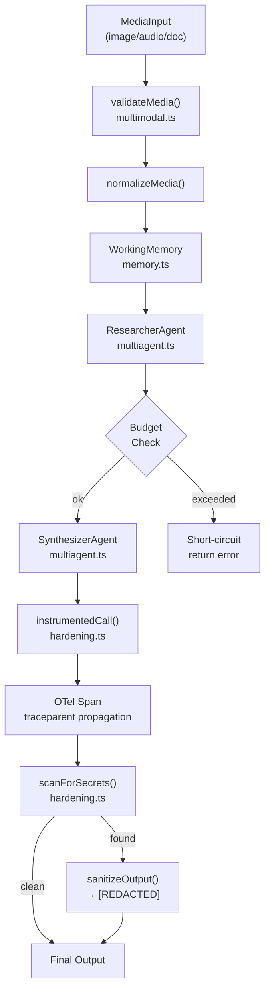

# Лабораторна робота №4 — Підсумковий Звіт

**Курс:** Agentic Engineering 2026–2027  
**Тема:** Застосування харнесу до успадкованого коду і продакшн-деплой мультиагентної функціональності  
**Репозиторій (курсовий):** https://github.com/VladykaMarkiyan/2026-2027-agentic-course-starter  
**Форк (brownfield):** https://github.com/VladykaMarkiyan/defu

---

## Таблиця Прийняття (Acceptance Table)

| Крок | Артефакт | Статус | Доказ |
|------|----------|--------|-------|
| **00** Context Recovery | [`docs/lab4/context.md`](context.md) | ✅ | Коміт [`8103e56`](https://github.com/VladykaMarkiyan/2026-2027-agentic-course-starter/commit/8103e56) |
| **01** Characterization Tests | [`docs/lab4/characterization.md`](characterization.md) | ✅ | Fork commit [`bfc8219`](https://github.com/VladykaMarkiyan/defu/commit/bfc8219cf2895142963c24e4f287c19ba23ecd60) |
| **02** Isolated Change & Rollback | [`docs/lab4/change.md`](change.md), [`rollback.md`](rollback.md) | ✅ | Коміт [`bc74173`](https://github.com/VladykaMarkiyan/2026-2027-agentic-course-starter/commit/bc74173) |
| **03** Multi-Agent Pipeline | [`docs/lab4/multiagent.md`](multiagent.md) | ✅ | Коміт [`477bb4b`](https://github.com/VladykaMarkiyan/2026-2027-agentic-course-starter/commit/477bb4b) |
| **04** Memory Layer & Deep Research | [`docs/lab4/memory.md`](memory.md) | ✅ | Коміт [`4572b3b`](https://github.com/VladykaMarkiyan/2026-2027-agentic-course-starter/commit/4572b3b) |
| **05** Multimodal Input | [`docs/lab4/multimodal.md`](multimodal.md) | ✅ | Коміт [`b0a9160`](https://github.com/VladykaMarkiyan/2026-2027-agentic-course-starter/commit/b0a9160) |
| **06** Hardening | [`docs/lab4/hardening.md`](hardening.md) | ✅ | Коміт [`88c4945`](https://github.com/VladykaMarkiyan/2026-2027-agentic-course-starter/commit/88c4945) |
| **07** Cost Audit | [`docs/lab4/cost.md`](cost.md) | ✅ | Коміт [`213146a`](https://github.com/VladykaMarkiyan/2026-2027-agentic-course-starter/commit/213146a) |
| **08** Peer Reproducibility | [`docs/lab4/repro.md`](repro.md) | ✅ | Коміт [`23b7ffe`](https://github.com/VladykaMarkiyan/2026-2027-agentic-course-starter/commit/23b7ffe) |
| **09** Final Package | [`docs/lab4/README.md`](README.md) | ✅ | Цей файл |

---

## Ключові Метрики

| Метрика | Значення |
|---------|----------|
| Загальна кількість тестів (курсовий repo) | **192 passed / 192** |
| Характеризаційних тестів (defu fork) | **7 passed / 7** |
| Mutation score (defu — Step 01) | **87.38%** (83 killed / 103) |
| Час відкату (Step 02 rollback drill) | **4.67 секунди** (ліміт 60s) |
| Fact retention: критичні факти (Step 04) | **100% (6/6)** |
| Fact retention: вторинні факти (Step 04) | **83.3% (5/6)** ≥ 80% вимога |
| Context reduction (Step 04) | **41%** |
| Мультимодальні тести (Step 05) | **8/8** |
| Hardening тести (Step 06) | **14/14** |
| Grand total tokens на pipeline run (Step 07) | **5,213 tokens** |
| Grand total USD на pipeline run (Step 07) | **\$0.000521** |
| Spend limit budget used | **5.21%** (\$0.000521 / \$0.01) |

---

## Архітектура Пайплайну



---

## Захист: Що Сказати про Кожен Файл

### Step 00 — context.md
> «Нульова точка проєкту: SHA `82632b66`, 5 ключових файлів, граф залежностей Mermaid,
> 3 перевірені факти з перманентними посиланнями, 3 зони ризику (proto pollution,
> Symbol keys, array dedup), 3 відкриті питання.»

### Step 01 — characterization.md
> «7 характеризаційних тестів, що фіксують поточну поведінку `defu` без рефакторингу.
> 100% coverage (Stmts/Branch/Funcs/Lines). Mutation score 87.38% — 83 мутанти вбито.
> Гілка `test/characterization-tests`, коміт `bfc8219` у форку.»

### Step 02 — change.md + rollback.md
> «Нова функція `defuDedup` у 8 рядках production-коду. 3 нових тести. Всі 33 тести
> проходять. Rollback drill: `git revert 14222f1` → 4.67 секунди (в 13 разів менше ліміту).»

### Step 03 — multiagent.md
> «ResearcherAgent + SynthesizerAgent з Zod-схемами контрактів. Hard budget:
> 5 turns / 10k input tokens / 2k output tokens / 30s timeout. Short-circuit:
> Synthesizer не викликається при перевищенні. 5 тестів / 690ms.»

### Step 04 — memory.md
> «WorkingMemory (оперативна) + JsonPersistentMemoryStore (міжсесійна). Компактифікація
> при 75% заповненні. Fact Retention: 100% критичних (6/6), 83.3% вторинних (5/6).
> DeepResearchEngine: 4 підтеми, обмежений контекст.»

### Step 05 — multimodal.md
> «Валідація MIME, розміру та magic bytes (JPEG/PNG/MP3/WAV). Нормалізація. Оцінка
> токенів: image tiling (85 + tiles×170), audio (25 tok/s), doc (sizeBytes/4).
> Вартість: $0.0001/1k tokens. 8 тестів — 4 обов'язкових + 4 додаткових.»

### Step 06 — hardening.md
> «OTel spans з W3C traceparent propagation (traceId спільний для всього pipeline-виклику).
> Spend limit guard: pre-flight check, fn не викликається при перевищенні. Secret scanner:
> 8 regex-патернів (OpenAI, Bearer, AWS, GitHub PAT…). 14 тестів.»

### Step 07 — cost.md
> «Аудит повного pipeline-виклику: 5213 токенів = $0.000521. Агенти (53%),
> мультимодал (44%), memory+OTel (3%). Spend limit guard: 5.21% budget used.»

### Step 08 — repro.md
> «Протокол відтворення за 5 кроків: clone → pnpm install → typecheck → pnpm test →
> cost audit. 192/192 тестів PASSED з нуля. Верифіковано на Node 24.13.1 / pnpm 12.16.1.»

---

## Журнал Автономності

Повний журнал всіх 10 сесій агента: [`docs/lab4/autonomy-log.md`](autonomy-log.md)

---

## Відтворення

```bash
git clone https://github.com/VladykaMarkiyan/2026-2027-agentic-course-starter.git
cd 2026-2027-agentic-course-starter
pnpm install
pnpm run typecheck   # 0 помилок
pnpm test            # 192/192 PASSED
npx tsx scripts/run-cost-audit.ts  # 5213 tokens, $0.000521
```
