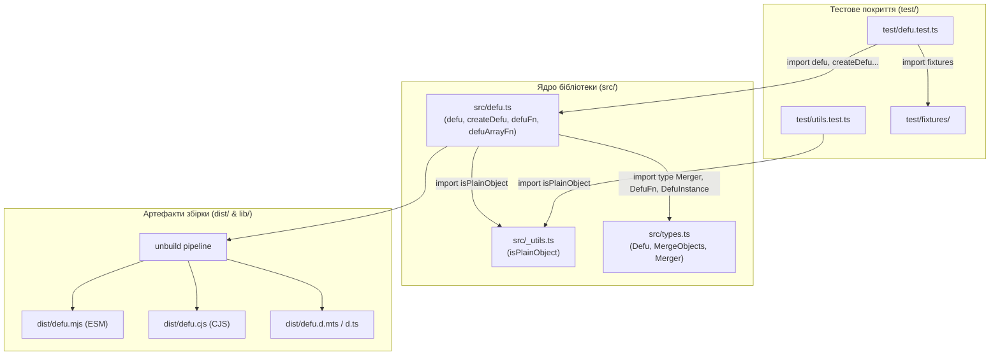

# Контекст успадкованого проєкту (Context Recovery)

## 1. Шапка
- **Посилання на форк:** [https://github.com/VladykaMarkiyan/defu](https://github.com/VladykaMarkiyan/defu)
- **Нульовий коміт (zero-point SHA):** [`82632b66f5914e9946edce300e10633a3d5c0cb7`](https://github.com/VladykaMarkiyan/defu/commit/82632b66f5914e9946edce300e10633a3d5c0cb7)
- **Дата та час зняття контексту:** 2026-11-23 15:58 UTC+2
- **Агент і модель:** Antigravity (Gemini 2.5 Flash / Pro)
- **Режим запуску:** `[READ-ONLY EXPLORATION]` (виключно читання та локальний запуск аналізу без правок)

---

## 2. Карта вхідних точок і ключових файлів

| № | Файл | Роль файлу в проєкті | Посилання на рядок у нульовому коміті |
|---|---|---|---|
| 1 | `src/defu.ts` | Головний модуль ядра: містить алгоритм рекурсивного злиття `_defu` та публічні фабрики `createDefu`, `defu`, `defuFn`, `defuArrayFn` | [`src/defu.ts#L5`](https://github.com/VladykaMarkiyan/defu/blob/82632b66f5914e9946edce300e10633a3d5c0cb7/src/defu.ts#L5) |
| 2 | `src/_utils.ts` | Допоміжні утиліти інспекції типів часу виконання: реалізує функцію `isPlainObject`, адаптовану з `is-plain-obj` для відсікання вбудованих об'єктів і модулів | [`src/_utils.ts#L3`](https://github.com/VladykaMarkiyan/defu/blob/82632b66f5914e9946edce300e10633a3d5c0cb7/src/_utils.ts#L3) |
| 3 | `src/types.ts` | Комплексні декларації типів TypeScript: рекурсивний тип `MergeObjects`, умовний мапінг `Defu` та інтерфейс `DefuInstance` для точної типізації результату | [`src/types.ts#L13`](https://github.com/VladykaMarkiyan/defu/blob/82632b66f5914e9946edce300e10633a3d5c0cb7/src/types.ts#L13) |
| 4 | `package.json` | Маніфест пакета: описує конфігурацію дуального експорту (ESM/CJS), нульові зовнішні runtime-залежності, скрипти збірки (`unbuild`) і тестів (`vitest`) | [`package.json#L14-L25`](https://github.com/VladykaMarkiyan/defu/blob/82632b66f5914e9946edce300e10633a3d5c0cb7/package.json#L14-L25) |
| 5 | `test/defu.test.ts` | Головний тестовий набір Vitest: покриває злиття вкладених об'єктів, конкатенацію масивів, захист від Prototype Pollution, кастомні мерджери та статику типів | [`test/defu.test.ts#L9`](https://github.com/VladykaMarkiyan/defu/blob/82632b66f5914e9946edce300e10633a3d5c0cb7/test/defu.test.ts#L9) |

---

## 3. Граф залежностей

### Зовнішні бібліотеки (з `package.json`)
- **Runtime-залежності (`dependencies`):** **0** (нуль зовнішніх залежностей, проєкт повністю self-contained).
- **Dev-залежності (`devDependencies`):**
  - `vitest` (`^4.1.6`) та `@vitest/coverage-v8` (`^4.1.6`) — тест-ранер і вимірювання покриття.
  - `typescript` (`^6.0.3`) та `@typescript/native-preview` (`7.0.0-dev.20260516.1`) — компілятор типів.
  - `unbuild` (`^3.6.1`) — бандлер для генерації `dist/defu.mjs`, `dist/defu.cjs` та файлів декларацій `.d.ts`.
  - `oxlint` (`^1.65.0`) та `oxfmt` (`^0.50.0`) — лінтер і форматер на базі Rust.
  - `expect-type` (`^1.3.0`) — type-level тестування сигнатур у тестах (`expectTypeOf`).
  - `changelogen` (`^0.6.2`) — автоматизація релізів на базі Conventional Commits.
  - `@types/node` (`^25.8.0`) — базові тайпінги Node.js.

### Внутрішні модулі та напрямок зв'язків

---

## 4. Три верифіковані факти

1. **Захист від прототипного забруднення (Prototype Pollution):**
   - *Факт:* Алгоритм `_defu` безумовно ігнорує ключі `"__proto__"` та `"constructor"` при обході властивостей об'єкта, запобігаючи перезапису ланцюжка прототипів `Object.prototype`.
   - *Доказ у коді:* [`src/defu.ts#L13-L15`](https://github.com/VladykaMarkiyan/defu/blob/82632b66f5914e9946edce300e10633a3d5c0cb7/src/defu.ts#L13-L15)
   - *Доказ у тестах:* [`test/defu.test.ts#L104-L113`](https://github.com/VladykaMarkiyan/defu/blob/82632b66f5914e9946edce300e10633a3d5c0cb7/test/defu.test.ts#L104-L113) (`it("should not extend Object prototype", ...)`)

2. **Конкатенація масивів за замовчуванням (Array Prepending):**
   - *Факт:* Якщо властивість є масивом і в цільовому об'єкті, і в дефолтах, `defu` об'єднує їх шляхом конкатенації зі збереженням пріоритету значень користувача попереду дефолтних: `[...value, ...object[key]]`.
   - *Доказ у коді:* [`src/defu.ts#L27-L28`](https://github.com/VladykaMarkiyan/defu/blob/82632b66f5914e9946edce300e10633a3d5c0cb7/src/defu.ts#L27-L28)
   - *Доказ у тестах:* [`test/defu.test.ts#L34-L40`](https://github.com/VladykaMarkiyan/defu/blob/82632b66f5914e9946edce300e10633a3d5c0cb7/test/defu.test.ts#L34-L40) (`it("should concat array values by default", ...)`)

3. **Перехоплення злиття кастомною функцією (Merger Interception):**
   - *Факт:* Користувацька функція-мерджер `merger(object, key, value, namespace)` викликається перед стандартною логікою злиття; якщо вона повертає `truthy`, злиття для даного ключа вважається завершеним і стандартний крок пропускається.
   - *Доказ у коді:* [`src/defu.ts#L23-L25`](https://github.com/VladykaMarkiyan/defu/blob/82632b66f5914e9946edce300e10633a3d5c0cb7/src/defu.ts#L23-L25)
   - *Доказ у тестах:* [`test/defu.test.ts#L132-L149`](https://github.com/VladykaMarkiyan/defu/blob/82632b66f5914e9946edce300e10633a3d5c0cb7/test/defu.test.ts#L132-L149) (`it("custom merger", ...)`)

---

## 5. Три зони ризику

1. **Неконтрольована рекурсія при циклічних посиланнях (Circular References):**
   - *Чому це ризик:* Функція `_defu` рекурсивно викликає саму себе для вкладених об'єктів без перевірки наявності циклів через `WeakSet` чи лічильника глибини. При обробці об'єкта, що містить посилання на самого себе, Node.js завершить процес аварійною помилкою `RangeError: Maximum call stack size exceeded`.
   - *Як захистити:* До початку будь-яких правок зафіксувати поведінку тестом-характеризацією (Characterization Test) на граничну глибину вкладеності або циклічні структури.

2. **Розходження поведінки в рантаймі та складних TypeScript-типах:**
   - *Чому це ризик:* Тип `MergeObjects<Destination, Defaults>` у `src/types.ts` містить глибокі умовні типи (`Destination extends Defaults ? ... : Omit<...> & { ... }`). Будь-яка зміна порядку злиття або обробки `null`/`undefined` у рантаймі без синхронної зміни типів призведе до хибного виведення типів у клієнтських проєктах (Nuxt, Nitro).
   - *Як захистити:* Обов'язкова валідація змін через `expectTypeOf` у Vitest та запуск повної перевірки типів `tsc --noEmit` до створення коміту.

3. **Спеціальні класи та складні інстанси, що маскуються під `isPlainObject`:**
   - *Чому це ризик:* Утиліта `isPlainObject` перевіряє ланцюжок прототипів (`prototype === Object.prototype`). Якщо сторонній об'єкт має кастомний конструктор або символи ітератора, він трактується як атомарне значення і копіюється за посиланням, а не клонується. Необережні зміни в `src/_utils.ts` можуть поламати сумісність з інстансами `Date`, `RegExp` або класами сторонніх бібліотек.
   - *Як захистити:* Закріпити характеристичними тестами всі граничні типи даних (`new Date()`, `new RegExp()`, `new CustomClass()`, `Map`, `Set`).

---

## 6. Три відкриті запитання

1. **Призначення збережених у git файлів `lib/defu.cjs` та `lib/defu.d.cts`:**
   - *Суть запитання:* Чому в репозиторії явно закомічені статичні файли в папці `lib/`, якщо команда збірки `unbuild` компілює код у папку `dist/`?
   - *Де знайти відповідь:* Історія комітів (`git log -S "lib/defu.cjs"`), документація релізів UnJS та PR для підтримки сумісності зі старими CJS-клієнтами без етапу `prepack`.
   - *Критичність для подальших кроків:* **Low** (не заважає розширенню ядра в `src/`).

2. **Бажана поведінка при злитті масивів однакових примітивів (Deduplication):**
   - *Суть запитання:* Чи є конкатенація без дедуплікації (`[1, 2]` + `[2, 3]` -> `[1, 2, 2, 3]`) суворо фіксованим контрактом, чи проєкт передбачає опціональні режими злиття множин (Set-like merge)?
   - *Де знайти відповідь:* Issue tracker репозиторію `unjs/defu` та тести фабрики `createDefu`.
   - *Критичність для подальших кроків:* **Medium** (важливо для вибору нової функції у Кроці 02).

3. **Конфігурація закінчень рядків (CRLF vs LF) для кросплатформного лінтингу:**
   - *Суть запитання:* Чому команда `oxfmt --check` на Windows після `git clone` повідомила про помилки форматування у вихідних файлах?
   - *Де знайти відповідь:* Налаштування `core.autocrlf` у git та конфігурація `.editorconfig` / `.oxfmtrc.json`.
   - *Критичність для подальших кроків:* **Low** (вирішується запуском форматування або збереженням LF).
