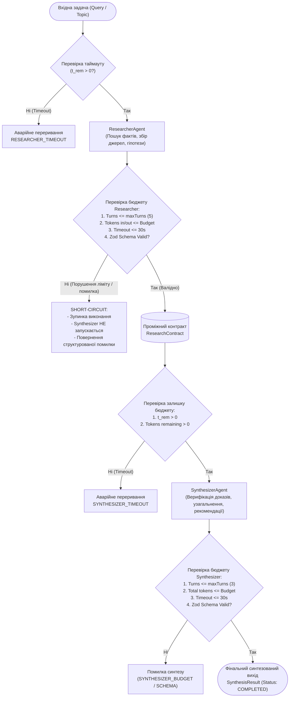

# Мультиагентний пайплайн із жорстким бюджетом (Multi-Agent Pipeline)

## 1. Архітектурна діаграма

Пайплайн реалізує спільну роботу двох спеціалізованих агентів із суворими точками валідації бюджету та аварійного переривання (**Short-Circuit**):



### Ролі агентів:
1. **ResearcherAgent:**
   - *Відповідальність:* дослідження проблемної області, виділення фактів із цитуванням джерел, оцінка рівня достовірності (confidence score $\in [0, 1]$), генерація робочих гіпотез.
   - *Вихід:* типізований об'єкт `ResearchContract`.
2. **SynthesizerAgent:**
   - *Відповідальність:* критичний аналіз отриманого контракту дослідника, фільтрація низькодостовірних фактів, структурування ключових пунктів, формулювання виконавчого резюме та рекомендацій.
   - *Вихід:* фінальний об'єкт `SynthesisResult`.

---

## 2. JSON-схема контракту між агентами

Контракт строго валідується через `zod` (`src/agent/multiagent.ts`).

### Схема проміжного контракту (`ResearchContractSchema`)
```json
{
  "$schema": "http://json-schema.org/draft-07/schema#",
  "title": "ResearchContract",
  "type": "object",
  "required": ["topic", "findings", "summary"],
  "properties": {
    "topic": { "type": "string" },
    "findings": {
      "type": "array",
      "minItems": 1,
      "items": {
        "type": "object",
        "required": ["fact", "source", "confidence"],
        "properties": {
          "fact": { "type": "string" },
          "source": { "type": "string" },
          "confidence": { "type": "number", "minimum": 0, "maximum": 1 }
        }
      }
    },
    "hypotheses": {
      "type": "array",
      "items": { "type": "string" },
      "default": []
    },
    "summary": { "type": "string" }
  }
}
```

### Схема фінального результату (`SynthesisResultSchema`)
```json
{
  "$schema": "http://json-schema.org/draft-07/schema#",
  "title": "SynthesisResult",
  "type": "object",
  "required": ["topic", "executiveSummary", "verifiedKeyPoints", "recommendation", "confidenceScore"],
  "properties": {
    "topic": { "type": "string" },
    "executiveSummary": { "type": "string" },
    "verifiedKeyPoints": {
      "type": "array",
      "minItems": 1,
      "items": { "type": "string" }
    },
    "recommendation": { "type": "string" },
    "confidenceScore": { "type": "number", "minimum": 0, "maximum": 1 }
  }
}
```

---

## 3. Конфігурація бюджету та правила Short-Circuit

### Параметри бюджету за замовчуванням (`DEFAULT_PIPELINE_BUDGET`)
| Параметр | Ліміт | Призначення |
|---|---|---|
| `maxResearcherTurns` | **5 кроків** | Максимальна кількість взаємодій Researcher із моделлю/інструментами |
| `maxSynthesizerTurns` | **3 кроки** | Максимальна кількість кроків Synthesizer |
| `maxInputTokens` | **10 000 токенів** | Загальний вхідний ліміт токенів на весь пайплайн |
| `maxOutputTokens` | **2 000 токенів** | Загальний вихідний ліміт генерації токенів на весь пайплайн |
| `timeoutMs` | **30 000 мс (30с)** | Стінка таймауту (wall-clock timeout) від початку виклику пайплайну |

### Правила аварійного переривання (Short-Circuit Policy):
1. **Zero-Waste Invocation:** Якщо Researcher перевищив свій ліміт кроків, токенів, повернув невалідну за схемою відповідь або викинув виняток — Synthesizer **ніколи не викликається**. Витрата додаткових токенів на синтез блокується миттєво.
2. **Remaining Token Budgeting:** Токени, спожиті Researcher, віднімаються із загального балансу пайплайну. Synthesizer отримує залишок (`maxInputTokens - usedInput`, `maxOutputTokens - usedOutput`).
3. **Hard Timeout Protection:** Якщо перед запуском Synthesizer сумарний час перевищив `timeoutMs`, пайплайн завершується зі статусом `RESEARCHER_TIMEOUT` без запуску синтезатора.

---

## 4. Результати трьох тестових прогонів

Всі прогони верифіковано тестами в [`tests/multiagent.test.ts`](file:///C:/Users/marki/.gemini/antigravity/scratch/2026-2027-agentic-course-starter/tests/multiagent.test.ts) та сценарієм [`scripts/run-multiagent-runs.ts`](file:///C:/Users/marki/.gemini/antigravity/scratch/2026-2027-agentic-course-starter/scripts/run-multiagent-runs.ts).

### Прогін 1: Нормальний успішний запуск (Baseline Happy Path)
- **Тема:** `TypeScript Brownfield Modernization`
- **Перебіг:**
  - Researcher виконав 2 кроки (1 200 input / 350 output токенів) за 420 мс, сформував валідний `ResearchContract`.
  - Synthesizer верифікував контракт за 1 крок (950 input / 280 output токенів) за 310 мс.
- **Статус:** `success: true`, `shortCircuited: false`, `terminationReason: 'COMPLETED'`.
- **Фінальний вихід:** Успішно сформовано об'єкт `SynthesisResult` (достовірність 0.96).

### Прогін 2: Перевищення бюджету першим агентом (Short-Circuit Triggered)
- **Тема:** `Large Knowledge Ingestion`
- **Перебіг:**
  - Researcher на 3-му кроці згенерував запит на 14 500 вхідних токенів, що перевищило ліміт `maxInputTokens: 10000`.
  - Пайплайн миттєво заблокував запуск другого агента.
- **Статус:** `success: false`, `shortCircuited: true`, `terminationReason: 'RESEARCHER_BUDGET_EXCEEDED'`.
- **Synthesizer:** статус `skipped` (0 кроків, 0 токенів, 0 мс). Повна економія ресурсів.

### Прогін 3: Аварійне завершення через таймаут (Emergency Timeout)
- **Тема:** `Deep Exhaustive Crawl`
- **Конфігурація:** тестовий ліміт `timeoutMs: 1000` (1 секунда).
- **Перебіг:**
  - Researcher виконував повільну операцію 1 500 мс, що перевищило таймаут пайплайну.
  - Пайплайн перервав виконання і не допустив запуску Synthesizer.
- **Статус:** `success: false`, `shortCircuited: true`, `terminationReason: 'RESEARCHER_TIMEOUT'`.
- **Synthesizer:** статус `skipped` (0 кроків, 0 токенів).

---

## 5. Таблиця витрат токенів і часу для кожного прогону

| Метрика | Прогін 1 (Нормальний) | Прогін 2 (Перевищення бюджету) | Прогін 3 (Таймаут) |
|---|---|---|---|
| **Researcher Turns** | 2 | 3 | 2 |
| **Researcher Input Tokens** | 1 200 | 14 500 *(Overbudget)* | 800 |
| **Researcher Output Tokens** | 350 | 520 | 200 |
| **Researcher Duration** | 420 мс | 550 мс | 1 500 мс *(Timeout)* |
| **Researcher Status** | `success` | `budget_exceeded` | `timeout` |
| **Synthesizer Turns** | 1 | **0 (Skipped)** | **0 (Skipped)** |
| **Synthesizer Input Tokens** | 950 | **0** | **0** |
| **Synthesizer Output Tokens** | 280 | **0** | **0** |
| **Synthesizer Duration** | 310 мс | **0 мс** | **0 мс** |
| **Synthesizer Status** | `success` | `skipped` | `skipped` |
| **Total Input Tokens** | 2 150 | 14 500 | 800 |
| **Total Output Tokens** | 630 | 520 | 200 |
| **Total Duration** | 730 мс | 550 мс | 1 500 мс |
| **Short-Circuit спрацював?** | Ні (штатно) | **ТАК (Synthesizer захищено)** | **ТАК (Synthesizer захищено)** |
| **Фінальний статус** | **COMPLETED** | **RESEARCHER_BUDGET_EXCEEDED** | **RESEARCHER_TIMEOUT** |
